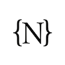
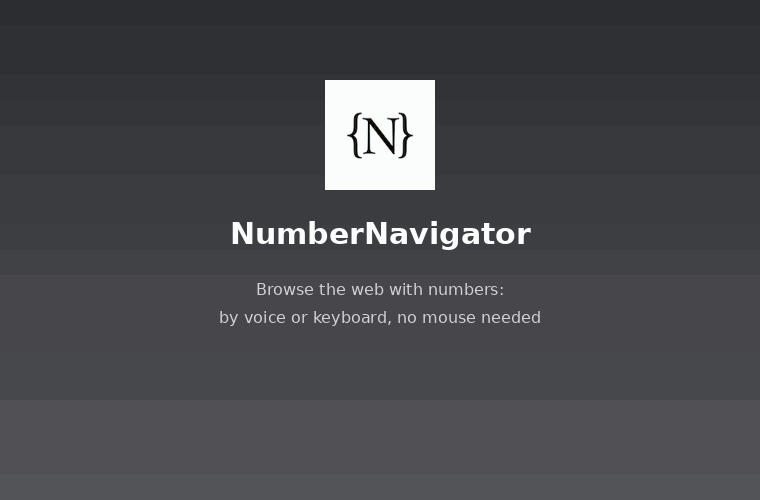

<p align="center">
  
</p>

<p align="center">
  
</p>

# NumberNavigator

NumberNavigator is a browser extension designed for hands-free and keyboard-driven navigation of web pages using numbers. It allows users to interact with web elements and scroll pages by speaking or typing numbers.

## Core Features

*   **Voice or Keyboard-controlled clicking:** say or type the number shown next to any visible link, button, checkbox, menu, tab or field.
*   **Flexible Navigation Methods:** choose 🎤 Voice, ⌨️ Keyboard, or both. Settings remember your selection and ensure at least one method remains active.
*   **Keyboard Timeout & Matching:** typed digits accumulate in a buffer (e.g. `1` then `2` within the timeout gives `12`). Confirm immediately with `Enter`, edit with `Backspace`, or cancel/blur text fields with `Esc`. Unambiguous numbers run immediately without waiting for timeout.
*   **Offline Mode:** keyboard navigation works completely offline without requiring microphone access or an internet connection.
*   **Text fields:** saying or typing a field's number puts the cursor in it, ready to type or dictate. Digits are ignored while typing inside form inputs.
*   **Controlled scrolling:** say or type "0" to scroll down and "1" to scroll up (works on pages that scroll inside a container too).
*   **Stable numbers:** an element keeps its number while it is on screen; numbers refresh automatically after scrolling, resizing or page changes.
*   **Clear feedback:** a toast on the page confirms every command ("Clicked 12"), and matching badges highlight dynamically as you type digits.
*   **Multi-language:** English, Spanish, Italian, French, German, Arabic and Japanese. Digits ("21") and words ("twenty-one") are both understood for voice commands. The language is remembered.
*   **Follow cursor (optional):** turn it on in the control tab and a hairline empty square follows the mouse pointer. Numbers are shown, and available, only for elements inside the square; the rest of the page is not numbered. The square size is selectable. Voice, keyboard, scrolling and all other features work as usual.
*   **Extra clickable elements (built in):** besides links, buttons and fields, the extension also numbers custom widgets such as hamburger menus (e.g. Wikipedia's), ARIA toggles, elements the page made clickable with scripts and elements shown with a pointer cursor. Always active, no setting needed. Detection is a list of pluggable *detectors* (`extraDetectors` in `src/content.ts`): to support another kind of clickable element, add one entry there. Click listeners are spotted by `src/page-hook.ts`, which runs in the page and only adds a `data-nn-listener` attribute to elements that receive click/mouse/pointer listeners.
*   **Show / hide numbers (command number):** say or type a configurable number (default **99**) to hide the numbers, and the follow-cursor square if present; say or type it again to show them. While hidden the extension keeps listening, only that number works, and a small red dot near the pointer tells you the numbers are off.
*   **Non-intrusive:** labels are drawn in an overlay; the page's own layout and styles are not modified.

## How to Use

1.  **Install** (same package for both browsers; unzip it first, or use `dist/numbernavigator/browser` after building):
    *   **Google Chrome:** open `chrome://extensions` -> enable *Developer mode* -> *Load unpacked* -> select the folder.
    *   **Microsoft Edge:** open `edge://extensions` -> enable *Developer mode* (left sidebar) -> *Load unpacked* -> select the folder.
2.  Click the toolbar icon: the **control tab** opens. Choose your preferred navigation method (Voice, Keyboard, or Both). Press **Start** (and allow the microphone if Voice is enabled).
3.  Switch to the website you want to control. **Keep the control tab open** (it can stay in the background).
4.  Say or type the yellow number next to what you want to click. Say/type **0** to scroll down, **1** to scroll up.
5.  Say/type **99** (or the command number you set) to hide the numbers temporarily, and again to show them.
6.  Press **Stop** (in the control tab) to remove the numbers and deactivate navigation.

**Notes**

*   Speech recognition uses the browser's online service, so an internet connection is required when using Voice mode. Keyboard mode works completely offline.
*   Works on `http`/`https` pages only (not `chrome://` / `edge://` pages, the Chrome Web Store, Edge Add-ons or local files).
*   Supported browsers: Google Chrome and Microsoft Edge (version 111 or later). Internet Explorer is not supported.
*   On Edge/Windows, if the microphone starts but nothing is recognized, check *Settings -> Privacy -> Speech -> Online speech recognition*.
*   Numbers 2-200 are assigned, in page order, to elements currently visible in the window.
*   Numbers are never assigned to elements hidden behind other content (modals, sticky bars).

## Features in detail

### Follow cursor

An optional mode (control tab -> *Follow cursor*, saved between sessions, off by default).

*   A hairline, empty square (1 px border) is drawn around the mouse pointer and follows it.
*   Numbers exist **only** for the elements that overlap the square; the rest of the page is not numbered, and numbers outside the square cannot be said or typed. Elements keep their number while they stay inside the square.
*   The side of the square can be chosen in the control tab (200, 320, 480 or 640 px; default 320 px). Until the mouse moves, the square is centred in the window.
*   Everything else (voice and keyboard, scrolling with 0/1, toasts, languages) works as usual. The square is clipped to the window and is never drawn above the page's own layout: it lives in the same non-intrusive overlay as the numbers.

### Extra clickable elements

Links, buttons, fields and ARIA widgets are always numbered. On top of that, the extension has a **built-in** (not optional) set of *detectors* that find custom widgets which the standard selectors miss, for example the hamburger menu of Wikipedia:

| Detector | What it finds |
| --- | --- |
| `hidden-controls` | Transparent checkboxes/radios laid over a drawn button (the hamburger-menu pattern) and `aria-hidden` labels that toggle a control |
| `aria-widgets` | Elements with `aria-haspopup`, `aria-expanded`, `aria-controls`, `data-toggle`, `data-bs-toggle` |
| `page-listeners` | Elements to which the page attached a click/mousedown/mouseup/pointerdown/pointerup listener (`addEventListener` or `el.onclick = ...`) |
| `cursor-pointer` | Elements the page shows with a pointer (hand) cursor (only the outermost one of a region, because the cursor is inherited) |

How it works:

*   `src/page-hook.ts` runs in the **page's own JavaScript world** (`"world": "MAIN"` in the manifest, which is why Chrome/Edge 111+ is required). It wraps `addEventListener` and the `onclick`-style setters and only adds the attribute `data-nn-listener` to the elements concerned; the listener itself is not changed. Listeners on `window`, `document`, `<html>` and `<body>` are ignored. Tabs that were already open before the extension was installed or reloaded only report listeners registered afterwards (the other detectors work everywhere).
*   `src/content.ts` merges the candidates of all detectors with the standard ones, then applies the usual checks (visible, not covered by a modal or sticky bar) and some extra rules so that containers and duplicates are not numbered: very large elements (more than half of the window) are ignored, an extra element that contains other numbered elements is skipped (the innermost one wins), and a label whose control is already numbered does not get a second number.
*   Extra elements are clicked with a full mouse sequence (`pointerdown`, `mousedown`, `pointerup`, `mouseup`, `click`) at their centre, because custom widgets often react to `mousedown` or use event delegation instead of `click`.
*   A broken detector never breaks navigation: errors are caught and the detector is skipped.
*   **Adding a new kind of clickable element:** add an entry to the `extraDetectors` array in `src/content.ts`. A detector has an `id`, a `description` and a `collect()` function returning `{ el, extra: true, relax? }` candidates; `relax` (`transparent`, `ariaHidden`) switches off a visibility check for that candidate (for example an invisible overlay control).
*   Side effects: pages that register click listeners on many elements may show some extra numbers, and the `data-nn-listener` attribute appears in the page's DOM.

### Show / hide numbers (command number)

A number you choose lets you switch the numbers off and on without stopping the extension.

*   **Setting:** control tab -> *Show / hide numbers* -> *Command number*. Whole number from 2 to 200 (0 and 1 scroll the page, and voice recognition understands 0-200). Default **99**. The value is saved.
*   **Hide:** say or type the command number. Numbers disappear, and so does the follow-cursor square if it is on. A toast confirms it ("Numbers hidden - say or type 99 to show them").
*   **While hidden:** the extension stays active and listens (voice and/or keyboard), but **only the command number is recognised**: element numbers and scrolling (0/1) are ignored. Nothing is drawn on the page except a **small red dot near the mouse pointer**, which means "numbers are off, but you can bring them back at any moment". In the control tab the status line shows "Numbers hidden".
*   **Show again:** say or type the same number. Numbers (and the square) come back; numbers are assigned again from the elements currently visible.
*   **Keyboard details:** while hidden, digits are **not** intercepted: they reach the page normally and are only compared with the command number (typing it inside a text field never toggles). While visible, the command number is a valid number like any other, so with 99 a lone "9" waits for the keyboard timeout before it is accepted, because "99" could follow.
*   **Reserved number:** no element is ever given the command number; if you change it to a number an element already has, that element is renumbered.
*   **State:** it is shared between tabs (the new tab starts hidden if the numbers are hidden) and is reset to *visible* every time you press Start or Stop.

## Building from Source

To build NumberNavigator from the source code, you'll need Node.js and npm (which comes with Node.js) installed.

1.  **Clone the repository (if you haven't already):**
    ```bash
    git clone <repository-url>
    cd numbernavigator
    ```

2.  **Install dependencies:**
    ```bash
    npm install
    ```
    (`npm ci` also works: the unused `@angular-builders/custom-webpack` dependency that blocked it was removed.)

3.  **Build the extension:**
    ```bash
    npm run build
    ```
    This compiles the Angular app and, via `tsconfig.scripts.json`, the content and background scripts (works on Windows, macOS and Linux).

4.  **Locate the built extension:**
    The production-ready build of the extension will be available in the `dist/numbernavigator/browser` directory.

5.  **Load the unpacked extension:**
    Follow the installation instructions in the "How to Use" section, using the `dist/numbernavigator/browser` directory.

## Contributing

Contributions are welcome! If you have ideas for improvements, new features, or bug fixes, please feel free to:

1.  Fork the repository.
2.  Create a new branch for your feature or fix.
3.  Make your changes.
4.  Submit a pull request.

If you encounter any issues or have suggestions, please open an issue on the project's issue tracker.
